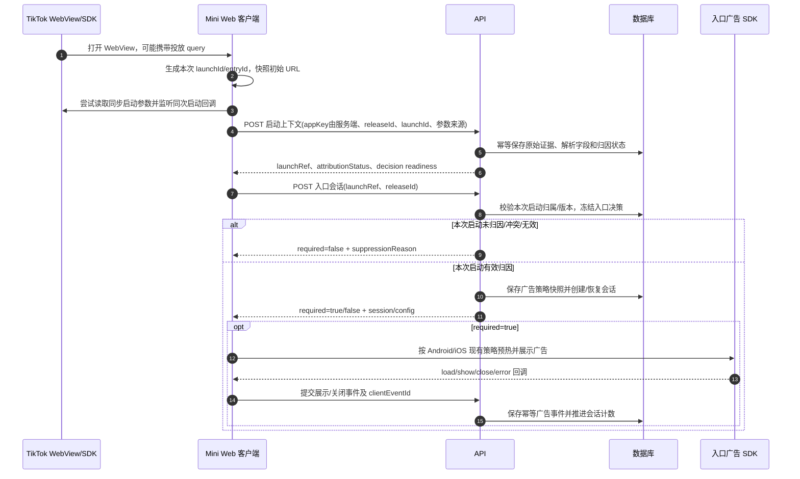

# v0.0.6-dual 启动归因与未归因入口豁免实施方案

> 实施状态（2026-11-13）：本地代码已完成并通过自动化验收，包含启动归因采集、未归因入口豁免、结构化启动/决策存储、脱敏诊断事件和管理后台查询。数据库迁移文件已生成，但尚未应用到任何数据库；生产部署和 Android/iOS 真机验收仍待执行。此次没有实现 IP 豁免功能。

## 1. 目标与范围

本方案只实现以下完整链路：

1. 小程序每次启动采集入口参数，形成可关联、可去重的启动记录。
2. 服务端判断本次启动是否归因，并将归因判断结果持久化。
3. 入口强弹广告使用服务端的本次启动判断；未归因用户不触发入口强弹。
4. 记录入口强弹展示/豁免决策及原因，能够从启动记录追查到入口会话和广告事件。

**不实现 IP 豁免名单、IP 自动采集、IP 跨包来源统计或任何基于 IP 的豁免。** 不改变剧集解锁、剧集插屏、退出挽留、Android 双广告位/iOS 单广告位和播放器逻辑。

## 2. 关键问题：所有用户都能取得 WebView 原始 URL 吗？

不能保证所有用户都能取得带完整投放参数的原始 URL。

当前客户端在启动模块初始化时读取 `window.location.href`，并尝试读取 TikTok 的 `getEnterOptionsSync()` / `getLaunchOptionsSync()`。因此，当投放链接确实把参数带入小程序 WebView，且容器没有清理或改写 URL 时，客户端通常可以取得类似本方案提供的完整 URL。用户贴出的记录证明**那一次启动**的 URL 参数对当前客户端可见。

这不是对所有用户、所有入口和所有 TikTok 客户端版本的保证：

- 自然搜索、收藏、分享、最近使用、桌面图标或应用内普通进入，可能没有投放参数。
- 平台或容器可能不把所有查询参数传入 WebView，或 SDK 启动参数与 WebView URL 不同。
- URL 可能在客户端脚本初始化前被路由/重定向改写；重新打开和前后台恢复也不能一概视为新的广告启动。
- URL 中存在参数不等于平台确认了付费归因；这是客户端可观察到的入口信号。
- SDK 原始回调 `{"code":1,"msg":"JSB_SUCCESS",...}` 是 JSBridge 调用成功响应，不包含投放归因证明。必须从 URL/启动 query 读取归因参数，不能把该回调解释为广告归因成功。

因此数据需区分 `AVAILABLE / PARTIAL / UNAVAILABLE / INVALID`，并记录参数来源。参数不存在时如实记“本次启动没有可用归因参数”，不得伪造或沿用该用户历史启动的 `adId`。

## 3. 当前项目实现基线

核对当前 `tiktok-project` 工作区源码后的现状：

- [launch-context.ts](../apps/mini-web/src/lib/launch-context.ts) 在模块初始化时保存 `window.location.href`，并尝试调用同步启动参数 API。URL 和 SDK query 会合并。
- 当前 `safeQuery` 最多取 32 个键，并把每个值截到 128 字符。你提供的 `ttclid/click_id` 明显长于 128 字符，因此调试摘要/结构化 query 可能已截断，不能用于精确对账；应针对已知 ID 字段采用明确的长度上限、超长状态和指纹，禁止静默截断。
- API 接受最多 32 KiB 的 `rawUrl`，将启动上下文写入 `AudienceActivityEvent` 的 JSON metadata；这并非具备字段约束、归因决策快照和完整关联键的专用归因存储。
- 当前归因函数仅从 `adId` 返回 `ATTRIBUTED / UNATTRIBUTED`，没有有效 ID 冲突、参数采集状态、来源优先级和独立平台确认状态。
- 当前入口会话可优先使用请求体中的 `adId`；当其缺省时会查询用户最近一次 `APP_LAUNCH_CONTEXT`。这可能把旧启动归因带入新启动，必须移除。
- `ENTRY_AD_ATTRIBUTION_GATE_ENABLED` 当前是可配置闸门；开启后，非归因启动会提前返回 `required:false`。需确认新 `v0.0.6-dual` 版本的生产配置确实开启此行为，并将其变成按 release 可观测、可灰度的明确策略。
- 入口会话现有接口及数据库已支持展示次数和完成状态，但没有统一的本次启动归因记录与入口豁免决策记录关联。

主要关联代码：[归因服务](../apps/api/src/services/launch-attribution.service.ts)、[启动上下文 API](../apps/api/src/modules/auth/routes.ts)、[入口广告 API](../apps/api/src/modules/app-entry-ads/routes.ts)、[入口广告客户端](../apps/mini-web/src/features/ads/app-entry-ad.ts)、[入口门禁组件](../apps/mini-web/src/components/EntryAdGate.tsx)。

## 4. 产品判定口径

### 4.1 本地启动归因

本方案所说“归因”是**本次启动的本地投放来源判定**，不是 TikTok 平台确认的付费归因。

- `ATTRIBUTED`：本次启动采集到唯一、有效的 `adId`。
- `UNATTRIBUTED`：本次参数采集已完成，但没有有效 `adId`；记录缺失、空值或占位值等具体原因。
- `PENDING`：启动参数仍可能由同一次启动的 SDK 回调补充，且处于配置的短暂收集窗口。
- `AD_ID_CONFLICT`：同一次启动的 URL/SDK 来源中出现多个不同的有效 `adId`。
- `INVALID`：参数存在但格式/长度校验不合格；需带具体原因，不能和自然流量混为一类。

唯一有效 `adId` 足以判为本地 `ATTRIBUTED`，不要求同时存在 `ttclid/click_id/ttoclid`。辅助字段用于丰富投放分析和检查参数完整度，不改变主归因结论。没有可验证的平台回执时 `platformAttributionStatus=UNKNOWN`。

### 4.2 未归因入口豁免

对启用本逻辑的新 `v0.0.6-dual` release：

- `ATTRIBUTED`：继续按该 release 的入口广告策略判断并执行强弹。
- `UNATTRIBUTED`：入口强弹豁免，返回 `required:false`，原因 `UNATTRIBUTED`。
- `PENDING`：等待同次启动参数的短窗口；窗口内不得重复发起入口会话。到期后按“未获得有效 adId”豁免入口强弹，并记录 `PENDING_TIMEOUT`，不伪装成已确认自然量。
- `AD_ID_CONFLICT` / `INVALID`：按未归因豁免入口强弹，明确记录 `AD_ID_CONFLICT` 或 `INVALID_ATTRIBUTION_SIGNAL`，避免参数异常导致用户被强弹或错误归类。
- attribution API/启动记录暂时不可用：使用独立故障策略。建议 fail-open（本次入口强弹豁免）以避免启动被广告门禁卡住，同时记 `ATTRIBUTION_UNAVAILABLE`；不得把它写成 `UNATTRIBUTED`。
- 已有用户豁免或入口策略关闭时仍跳过广告，但决策原因按优先级记录实际首个命中项。

以上豁免只作用于入口强弹，不修改其他广告位置。

## 5. 完整端到端链路



### 5.1 启动 ID 与幂等

- 每次真实冷启动/平台确认的新 launch 生成新的 `launchId` 和 `entryId`；同一次启动的重试、SDK 回调补报复用它们。
- 不可仅用长期复用的 `sessionStorage` 值充当每次 launch ID。需要验证 TikTok `onShow` 生命周期语义，区分冷启动、新启动与普通前台恢复。
- 服务端生成随机不可猜的 `launchRef`；客户端后续入口会话只引用它，不自行提交可覆盖本次判定的 `adId`。
- 唯一约束建议为 `(appKey, launchId)`；同一个启动多次收到 URL/SDK 证据时做幂等合并，保留每个来源的值、时间和冲突，不覆盖原始证据。
- 入口决策唯一关联 `launchRef`。重复请求返回同一冻结决策/会话，不能重复计数或因迟到参数重新弹广告。

### 5.2 参数提取与校验

在客户端尽早捕获初始 `window.location.href`，同时读取 TikTok 同步启动 query 和同次启动事件。对 URL 与 SDK query 分开解析，服务端再次校验，不接受客户端传来的归因状态作为权威结论。

重点字段：

| 字段 | 用途与处理 |
| --- | --- |
| `adId` | 主归因标识；校验非空、非占位、长度和允许字符。不同来源出现不同有效值则记冲突。 |
| `campaignId` / `adgroupId` / `creativeId` | 投放结构化 ID；分别记录原始来源、规范化值和校验状态。 |
| `ttclid` / `click_id` / `ttoclid` | 不透明点击/启动信号；分别记录来源、长度和安全指纹。`ttclid` 与 `click_id` 可比较是否一致，但不假设它们在所有场景语义相同。 |
| `campaignName` / `adgroupName` / `creativeName` / `adName` | 仅作排查展示，长度受限并转义；不参与归因主判定或 ID 映射。 |
| `placement` | 记录实际入口位置文字；不推断为平台确认信号。 |

规范化时不得重复 URL decode。用户示例中的 `%2520` 解一次后仍为 `%20`，这是编码层级现象；名称显示可在展示层安全解码一次，不能拿名称参与 ID 判断。查询参数可能重复，需保留重复值而非 `Object.fromEntries` 后静默覆盖。

超过字段上限时记录 `OVERSIZE` 和长度，不静默截断后当成有效值。点击 token、完整 raw URL 含敏感标识：原始证据仅按严格访问控制、加密/保留期策略存储；普通日志和客户端调试台不导出完整 token。可用于稳定匹配的指纹由服务端密钥 HMAC 生成。

### 5.3 归因与入口决策顺序

1. 验证 `launchRef` 存在、属于当前认证用户、`releaseId` 与启动记录一致。
2. 确认该启动的参数收集状态已完成；若处于 `PENDING`，只等待有限窗口。
3. 服务端依据已保存的原始证据计算本地归因状态和原因。
4. 未归因、冲突、无效或采集超时：保存 `SUPPRESS` 决策并返回 `required:false`。
5. 归因有效：读取该 `releaseId` 的入口策略，继续检查策略开关和用户级豁免。
6. 保存不可变决策快照及原因；如需要展示，再创建/恢复原有入口广告 session。
7. 客户端记录后续 `ad_load/ad_show/ad_close/ad_error` 等广告事实，服务端按现有 session 协议校验、计数。

归因信号只影响“是否具有入口强弹资格”，不得影响分集权益、奖励广告完播校验、广告计数证据或其他广告位。

## 6. 归因埋点与入口屏蔽埋点

所有事件用 `eventId` 幂等；客户端发生时间和服务器接收时间分开存储。客户端不传可信 `userId`，服务端从 token 写入当前身份。

### 6.1 `launch_attribution` 事件

每个 `launchId` 保存一份当前归因快照，并保留参数证据/更新历史。字段至少包括：

`eventId, appKey, releaseId, launchId, entryId, launchRef, occurredAt, receivedAt, source, collectionStatus, localAttributionStatus, attributionReason, adIdValueOrFingerprint, campaignId, adgroupId, creativeId, clickIdFingerprints, auxiliarySignalStatus, platformAttributionStatus, parserVersion, schemaVersion`

`source` 至少能区分 `WEBVIEW_URL`、`TIKTOK_SYNC_OPTIONS`、`TIKTOK_LIFECYCLE_CALLBACK`。如果多个来源均有参数，应记录每个来源，不把它们压扁成无法追查的单一 query。

### 6.2 `entry_ad_decision` 事件

由服务端在入口决策事务中创建，字段至少包括：

`decisionId, appKey, releaseId, launchId, launchRef, localAttributionStatus, decision(SHOW|SUPPRESS), reason, policyVersion, requiredCount, countMode, sessionId, requestId, decidedAt`

建议原因：

- `ENTRY_AD_REQUIRED`
- `POLICY_DISABLED`
- `UNATTRIBUTED`
- `PENDING_TIMEOUT`
- `AD_ID_CONFLICT`
- `INVALID_ATTRIBUTION_SIGNAL`
- `ATTRIBUTION_UNAVAILABLE`
- `USER_EXEMPT`

每次启动至少有一条最终入口决策，包含未归因豁免。`SUPPRESS` 只表示入口强弹跳过，不等同于用户在 TikTok 广告平台被屏蔽。

### 6.3 与广告事件关联

现有广告埋点继续携带 `launchId / releaseId / sessionId / operationId / eventId`；增加 `decisionId` 或 `launchRef` 关联键。这样可以区分：

- 有归因、服务端决定展示，但 SDK 加载/展示失败。
- 无归因、服务端决定豁免，因而根本没有广告 SDK 调用。
- 策略关闭、用户豁免、归因待定超时等其他跳过原因。

不能因没有 `ad_show` 记录就推断是未归因；必须查本次 `entry_ad_decision`。

## 7. 数据持久化设计

优先使用专用结构化数据表，而不是长期把所有事实放在 `AudienceActivityEvent.metadata` JSON 中。建议模型如下，最终命名遵循当前 Prisma 规范。

### `MiniAppLaunch`

- 主键：`id/launchRef`。
- 唯一键：`(miniAppKey, launchId)`。
- 字段：`userId`、`releaseId`、`entryId`、`firstSeenAt`、`lastEvidenceAt`、`collectionStatus`、`localAttributionStatus`、`attributionReason`、`platformAttributionStatus`、`parserVersion`、`decidedAt`。
- 仅保存本次启动状态和当前决策引用，不把用户历史归因复制进新行。

### `MiniAppLaunchSignal`

- 外键：`launchRef`。
- 字段：`source`、`signalKey`、安全存储值或 HMAC 指纹、`valueLength`、`validationStatus`、`occurredAt`、`receivedAt`、`rawEvidenceRef`。
- 唯一/去重键建议包含 `(launchRef, source, signalKey, valueFingerprint)`。
- 重复同名参数和多来源差异以多行保留，供冲突计算。

### `MiniAppEntryAdDecision`

- 唯一键：`launchRef`（每次启动冻结一次决策；若产品允许显式重新决策，需另行版本化，默认不允许）。
- 字段：归因状态快照、`SHOW/SUPPRESS`、原因、策略版本/配置快照、`requiredCount/countMode`、可空 `sessionId`、服务端 `requestId`、时间。
- 与现有广告 session、广告事件通过 ID 关联。

### 原始证据保留

完整 URL 与 SDK 原始对象只用于问题诊断，需单独制定加密、管理员访问审计和保留期；不建议把包含长点击 token 的 URL 永久写入普通事件 JSON、应用日志或导出文件。日常归因和报表读取规范化字段/指纹。原始证据过期清除后仍保留判断状态和指纹用于聚合。

### 迁移与旧数据

- 新增表/索引通过前向迁移创建；不重写历史迁移。
- 旧 `APP_LAUNCH_CONTEXT` 可按历史 JSON 尽力回填，但标记 `LEGACY_INFERRED`，不伪装为上线时已产生的权威决策。
- 旧启动没有可靠 `launchId/launchRef` 的，不从最近用户记录补全，不用于新版本入口资格。
- 发布前先备份并检查迁移锁、数据库容量和所有 API 副本版本；迁移可重复执行且有验证查询。

## 8. 接口契约建议

### 保存/补充本次启动证据

`POST /auth/launch-context`

请求携带：

```json
{
  "launchId": "uuid",
  "entryId": "uuid",
  "releaseId": "dramaflicks-v006-dual-...",
  "sourceSnapshots": [
    { "source": "WEBVIEW_URL", "rawUrl": "...", "queryEntries": [] },
    { "source": "TIKTOK_SYNC_OPTIONS", "queryEntries": [] }
  ],
  "capturedAt": "ISO-8601"
}
```

服务端从 app 路由与认证上下文确定 `appKey/userId`，解析参数并返回：

```json
{
  "launchRef": "opaque-reference",
  "collectionStatus": "COMPLETE",
  "localAttributionStatus": "ATTRIBUTED",
  "attributionReason": "VALID_AD_ID",
  "platformAttributionStatus": "UNKNOWN"
}
```

同一启动晚到来源使用相同 `launchId/entryId` 幂等补充。响应不回传完整敏感 token。

### 创建/恢复入口广告决策

`POST /app-entry-ad-sessions`

新客户端请求只传 `launchRef, releaseId, launchId`（launchId 用于一致性核对），不传可信归因结论或可覆盖的 `adId`。服务端返回原有广告 session 字段，并补充：

```json
{
  "required": false,
  "decisionId": "...",
  "decision": "SUPPRESS",
  "decisionReason": "UNATTRIBUTED",
  "launchRef": "..."
}
```

旧客户端短期兼容时，服务端需明确按 release 灰度；不得继续使用“当前请求的任意 adId”或“用户最近启动”作为长期兜底。通过埋点统计旧客户端比例后再移除旧契约。

## 9. 后台与彩蛋调试台

### 管理后台

- 启动查询支持 `launchId / launchRef / appKey / releaseId / userId / adId 指纹`。
- 列表展示本地归因状态、归因原因、参数来源是否可用、入口决定及是否跳过强弹。
- 详情展示 URL 与 SDK 来源的逐字段采集/校验/冲突结果、策略快照、服务端 `requestId`、session 及广告事件时间线。
- 明确区分“本地识别到投放参数”与“平台确认归因”，后者无凭据显示 `未知`。
- 未归因不等于平台屏蔽；UI 使用“未归因，已豁免入口强弹”等明确文案。

### 彩蛋调试台

- `Environment` 展示本次 `launchId/launchRef/releaseId` 和参数采集来源。
- `Events` 展示 `launch_attribution` 与 `entry_ad_decision`，包含状态和决策原因。
- `Network` 保留启动上下文与入口会话请求的状态码、耗时、request ID；敏感字段默认脱敏。
- 即使入口强弹被豁免，也必须看见服务端决策事件；没有广告 SDK 请求属于预期结果。
- 原始复制导出只包含脱敏数据；完整 raw URL/点击 token 不进入普通复制内容。

## 10. 文件修改清单

以下文件已按方案完成本地修改；未列出的广告位轮播、分集广告和播放器逻辑不属于本次实施范围。

### Mini Web 前端

| 文件 | 预期修改 |
| --- | --- |
| `apps/mini-web/src/lib/launch-context.ts` | 捕获本次启动 URL；分别保存 WebView URL、同步 SDK 参数和生命周期来源；保留重复参数；按字段验证长度，不静默 128 字符截断；建立真实 launch 生命周期 ID。 |
| `apps/mini-web/src/features/auth/anonymous-session.ts` | 启动上下文与匿名 session 关联同一 `launchId/entryId`；保存接口 ACK 后取得 `launchRef`；SDK 同次补报幂等更新。 |
| `apps/mini-web/src/features/ads/app-entry-ad.ts` | 入口请求改用 `launchRef + releaseId`；处理服务端 `decisionReason`，未归因豁免时不创建广告实例。 |
| `apps/mini-web/src/components/EntryAdGate.tsx` | 确保先完成本次启动记录/归因结果，再请求入口门禁；对 `PENDING` 只等待受限窗口，失败按明确故障策略继续。 |
| `apps/mini-web/src/lib/api-client.ts`、诊断/调试台相关模块 | 保存关联 ID、request ID 和服务端决策；脱敏展示归因证据，避免上传循环。 |
| `apps/mini-web/tests/launch-context.test.mjs`、`app-entry-ad.test.mjs`、`entry-ad-flow.test.mjs` | 覆盖原始 URL/SDK 参数组合、重复/冲突/超长、同次启动幂等、未归因豁免和决策关联。 |

### API 后端

| 文件 | 预期修改 |
| --- | --- |
| `apps/api/src/modules/auth/routes.ts` | 接收启动 ID 和多来源参数快照；服务端解析、幂等存储并返回 `launchRef`；敏感原始数据不写普通日志。 |
| `apps/api/src/services/launch-attribution.service.ts` | 扩展状态、有效性校验、重复/来源冲突检测、超长处理及 reason。 |
| `apps/api/src/modules/app-entry-ads/routes.ts` | 入口会话按 launchRef 查询本次归因；移除客户端 adId 覆盖和历史启动 fallback；生成幂等决策快照；未归因时返回入口豁免。 |
| `apps/api/src/modules/admin/routes.ts` 及后台页面/API 类型 | 提供归因与入口决策查询和详情；只读审计能力。 |
| `apps/api/prisma/schema.prisma` | 增加启动、信号、决策模型和索引。 |
| `apps/api/prisma/migrations/<timestamp>_launch_attribution_decisions/migration.sql` | 新建兼容迁移、唯一键、外键和查询索引。 |
| `apps/api/src/app.test.ts`、`apps/api/src/services/launch-attribution.service.test.ts` | 验证服务端归因与入口门禁端到端契约。 |

### 构建配置

核对四个包（DramaFlicks、HeartReel、SweetReel、LuxeReel）的构建脚本是否均生成独立 `releaseId` 并包含归因改动；不改变 Android 双广告位/iOS 单广告位配置。

## 11. 测试与灰度验收

### 自动化测试

1. 初始 WebView URL 有有效 `adId`、SDK query 无参数：本地归因成功，入口按策略执行。
2. 无 URL 参数但同步 SDK query 有有效 `adId`：来源记录为 SDK，归因成功。
3. 两来源相同 `adId`：合并为一条启动归因，不重复计数。
4. 两来源 `adId` 不同或 URL 有重复冲突值：`AD_ID_CONFLICT`，入口豁免并保留证据。
5. 没有有效 `adId`：`UNATTRIBUTED`，入口 `required:false`，原因可查询。
6. `ttclid/click_id` 长于 128 字符：不静默截断；长度/超限状态和 HMAC 可查，原始值不出现在普通日志/导出。
7. SDK 回调只有 `JSB_SUCCESS` 空 data：不产生归因成功结论。
8. 用户前一次启动归因、当前启动无参数：当前必须 `UNATTRIBUTED`，不得串用旧值。
9. 重复请求、匿名用户转 TikTok 身份：同次启动和入口决策幂等，关联不丢失、不重计。
10. 启动 API 超时：按 `ATTRIBUTION_UNAVAILABLE` 单独记录并执行 fail-open，不伪装自然量。
11. `v0.0.6-dual` 以外旧 release：沿用原行为，不被全局开关意外改动。
12. Android 双位与 iOS 单位：只验证与本方案无回归；未归因时两个平台都不启动入口广告 SDK。

### 灰度步骤

1. 部署向后兼容数据库迁移与 API，先观察旧客户端请求，不立即移除兼容字段。
2. 选一个新 `releaseId` 构建并上传单个小程序测试包。
3. 管理后台核对每次 `launchId` 的来源、归因结果、决策原因与广告事件关联。
4. 用自然进入、投放链接、缺少 `adId`、SDK 参数补充/冲突、弱网和前后台恢复进行真机验证。
5. 确认未归因用户不展示入口强弹；已归因用户仍按既有策略展示；旧 release 未变化后扩展其他包。
6. 达到稳定观察期后移除旧入口请求的 adId 信任和历史归因 fallback。

### 发布验收条件

- 每次启动可查唯一 `launchId`、`launchRef` 和本地归因结果。
- 每次入口决定可查 `SHOW/SUPPRESS`、原因和策略快照。
- 未归因、冲突、超限、等待超时、服务不可用能分开统计。
- 未归因入口豁免不影响其他广告业务。
- 原始 URL 不可用的启动能被识别为不可用/部分可用，而不是被误报成数据采集成功。
- 无官方归因回执时，平台归因字段保持未知。
- 所有自动化测试、四包构建和新旧 release 回归通过；Android/iOS 真机分别验收。

## 12. 尚需用真机确认的边界

- TikTok Mini Drama Android/iOS 在投放进入、自然进入、分享进入时，`window.location.href` 与同步启动选项分别能提供哪些字段。
- `onShow` 在前台恢复时是否携带原始启动参数，以及何种事件边界代表新 launch。
- URL 查询中单个参数的真实最大长度、平台是否重定向/删减参数；以脱敏真机观测设定字段上限。
- 是否存在可用的平台归因确认回执；在证实前只实现本地启动归因。

真机确认前的实现必须允许 URL、SDK query 任一来源缺失，并将缺失作为数据状态保存，不得假设所有用户都能获得同一份完整原始 URL。
