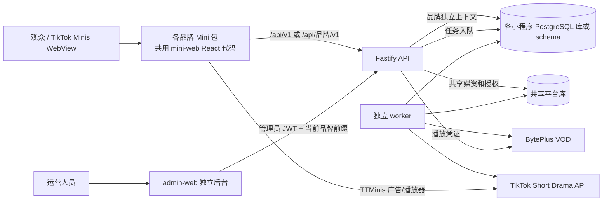

# QuicK ReeLS 项目全链路逻辑梳理

> 基于 2026-10-20 工作区代码梳理，覆盖 Mini 前台、运营后台、Fastify API、Prisma 数据、异步 worker、多小程序和部署。本文描述**当前实现**，不是最初 PRD 的目标状态。工作区当时存在未提交改动及新增小程序目录，尤其进入广告、StoryLand 和最新品牌配置；文中按当前磁盘文件记录。生产环境是否已经部署这些改动，需要另行核对部署版本。

## 1. 一页看懂



- **Mini 前台**：`apps/mini-web` 实现首页、详情、观看、个人页、收藏、法律页；各品牌目录只封装自己的构建配置和入口，复用同一套页面。入口见 [main.tsx](../apps/mini-web/src/main.tsx)、[router.tsx](../apps/mini-web/src/app/router.tsx)。
- **API**：`apps/api` 的一个 Fastify 进程按小程序分别挂载同一组路由，每个前缀绑定独立 Prisma 客户端、平台凭据和广告位。主应用 `/api/v1`，其他应用 `/api/<key>/v1`。见 [app.ts](../apps/api/src/app.ts)、[mini-apps.ts](../apps/api/src/config/mini-apps.ts)。
- **运营后台**：`apps/admin-web` 是独立网站。切换“当前小程序”时切换 API 前缀、管理员 token、草稿与模板存储空间。见 [main.tsx](../apps/admin-web/src/main.tsx)、[admin-api.ts](../apps/admin-web/src/admin-api.ts)。
- **数据与任务**：Prisma/PostgreSQL 保存内容、用户、广告证据、播放、任务和审计；原视频由 BytePlus 持有；平台发布/授权经 API 入队后由独立 worker 执行。见 [schema.prisma](../apps/api/prisma/schema.prisma)、[tiktok-short-drama.worker.ts](../apps/api/src/jobs/tiktok-short-drama.worker.ts)。
- **共享契约**：前后台与 API 使用 `packages/shared-types` 的公开 DTO；API 的内部模型与后台专用返回类型仍有各自定义。见 [shared-types](../packages/shared-types/src/index.ts)。

## 2. 仓库结构与运行单元

| 路径 | 职责 | 构建/运行结果 |
| --- | --- | --- |
| `apps/mini-web` | 主 Mini H5 和所有品牌共用页面、SDK 封装、广告及播放器流程 | 主应用 Vite 产物、TikTok Mini ZIP |
| `apps/<品牌>` | 品牌入口、`VITE_APP_KEY`、Vite、`minis.config.json`、公开环境样例、法律页导出 | 每品牌单独 Mini 包 |
| `apps/admin-web` | 中文运营控制台，按品牌切换 API | 独立静态网站/Nginx 容器，不进入 Mini ZIP |
| `apps/api` | Fastify 路由、权限、Prisma、服务适配、worker | API 容器与 worker 容器共用构建镜像 |
| `packages/shared-types` | Mini/API 共用的 Album、Episode、API DTO | workspace 包 |
| `deploy/website` | 各品牌隐私政策与条款的独立静态页面 | 外部网站部署材料 |
| `compose.production*.yml`、`deploy`、`infra` | 生产容器、PgBouncer、封面服务与代理样例 | 部署编排 |
| `docs` | 各专题手册、API 草案、本文 | 维护说明 |

根目录 [package.json](../package.json) 使用 pnpm workspace；常用命令是 `pnpm dev:api`、`pnpm dev:mini`、`pnpm dev:admin`、`pnpm dev:worker`、`pnpm db:generate`、`pnpm db:migrate`、`pnpm db:seed`。各应用自己的 `build`/`test` 在对应 `package.json`。本地默认 Mini 5173、后台 5174、API 3000、PostgreSQL 5432；各品牌 Vite 端口见各自配置。主包构建脚本见 [mini-web/package.json](../apps/mini-web/package.json)。

### 2.1 46 个小程序与组织边界

`miniAppKeys` 当前有 **46 个** key（包含 `main`），按组织分为：

| 组织 | 小程序 key | 数量 |
| --- | --- | ---: |
| Quick Reels | `main` | 1 |
| Gmart 挂靠 | `storyland`, `dramacloud`, `dailyreel`, `dramaone`, `dramaup`, `dramavault`, `talehub`, `talebox`, `storyworld`, `storyhub`, `dramaroom`, `dramazone`, `taleflick`, `dramashort`, `storyshort`, `storyflicks`, `dramaflicks`, `cinereels`, `taletv`, `talereels` | 20 |
| 香港长风 | `crownrush`, `sugarreel`, `crimsonshorts`, `sweetreel`, `dramablaze`, `heartreel`, `dramahit`, `crownreel`, `luxereel`, `elitedrama`, `sonicreel`, `harborplay`, `dazzleshort`, `fableclip`, `emberreel` | 15 |
| 飞书挂靠 | `lucidreel`, `astraclip`, `lumoreel`, `orbitplay`, `zenclip`, `auraclip`, `fluxplay`, `driftreel`, `novaclip`, `lumishort` | 10 |

以上是**代码认可的 key**，不代表 46 个都已在某台服务器启用：API 只为配置了对应 `<KEY>_DATABASE_URL` 的次级小程序挂载路由。`main` 总会挂载。每个应用必须用不同数据库或 PostgreSQL schema，启动时会检查重复连接目标。组织用于限制共享剧目授权范围，**同组织不等于共用用户库、管理员库或广告位**。后台的组织选择列表另在 `apps/admin-web/src/main.tsx` 维护，新增品牌要同时检查前后端映射。

品牌包通常在 `src/main.tsx` 导入共用 Mini 入口，Vite `define` 注入 `VITE_APP_KEY`，并使用共用 `public`。例如 [sonicreel/vite.config.ts](../apps/sonicreel/vite.config.ts)。`minis.config.json` 管 TikTok App ID、入口及 Portal 元数据；品牌 `.env` 管公开 API URL、Client Key。Client Secret、数据库密码和 BytePlus 密钥只放 API/worker 服务器环境。法律页正文选择见 [legal-docs.ts](../apps/mini-web/src/pages/legal-docs.ts)，独立网站导出见 [export-legal-pages.mjs](../apps/mini-web/scripts/export-legal-pages.mjs)。

## 3. Mini 前台：进入、页面和状态

### 3.1 启动顺序

1. 加载 [main.tsx](../apps/mini-web/src/main.tsx)：安装全局运行诊断，尝试 `TTMinis.init({clientKey})`，挂载 React Query 和路由。
2. [AppProviders](../apps/mini-web/src/app/providers.tsx) 并行确保匿名会话。普通品牌由 `EntryAdGate` 包住页面；**StoryLand 例外**，页面直接进入，付费流量的插屏尝试由首页的 `StoryLandEntryAd` 在入页后处理。
3. [anonymous-session.ts](../apps/mini-web/src/features/auth/anonymous-session.ts) 在本地持久化随机 `visitorKey`、本次 WebView 的 `clientSessionId`，调用 `POST /auth/anonymous/session`，把业务 JWT 放 `sessionStorage`。这是**业务匿名用户**，不是 TikTok 账号登录。401 时清 token、串行重建会话后重试原请求一次。
4. [api-client.ts](../apps/mini-web/src/lib/api-client.ts) 根据 `VITE_API_BASE_URL` 或 `VITE_APP_KEY` 决定 API 前缀，自动带 Bearer token，20 秒超时。`VITE_DEMO_MODE`/`VITE_USE_MOCK_API` 走本地 mock；`VITE_ENABLE_MOCK_FALLBACK` 允许网络错误时回退 mock。真机/生产应显式设为 `false`。注意 [storage.ts](../apps/mini-web/src/lib/storage.ts) 的 `isDemoMode()` 只有值恰好为字符串 `false` 才返回 false。
5. 广告门禁完成后进入 React Router。语言持久化在品牌前缀的 localStorage，公开语言码为 `en/pt/fr/id/ja/es/ko/th`；请求带 `locale`，服务端优先取对应翻译。UI 配置通过 `GET /ui-components` 获取，sessionStorage 缓存并由 React Query 短时刷新。

### 3.2 页面、交互与 API

| 路由/页面 | 当前界面与动作 | 主要 API |
| --- | --- | --- |
| `/` 首页 [HomePage](../apps/mini-web/src/pages/HomePage.tsx) | 热门/上新切换、轮播主推、视频预览、继续观看、海报列表、首页内搜索；搜索用 `?search=1&q=`，输入 320ms 防抖 | `GET /home?locale=...`，`GET /search?q=...`，`GET /ui-components` |
| `/search` | 兼容跳转到 `/?search=1`；另有 [SearchPage](../apps/mini-web/src/pages/SearchPage.tsx) 组件读取分类和搜索，但**当前 router 未直接挂载该组件** | `GET /genres`、`GET /search`（组件能力） |
| `/album/:albumId` 详情 [AlbumPage](../apps/mini-web/src/pages/AlbumPage.tsx) | 封面/简介/集列表、收藏、立即播放或先看激励广告；成功解锁后跳观看页 | `GET /albums/:id`、`GET /albums/:id/episodes`、`PUT /albums/:id/favorite`、广告会话接口 |
| `/watch/:albumId`、`/watch/:albumId/:episodeId` [WatchPage](../apps/mini-web/src/pages/WatchPage.tsx) | 当前集、集数抽屉、前后集/滑动切集、锁定集解锁、播放器错误重试；会预取相邻可播集 | `GET /albums/:id`、`GET /albums/:id/episodes`、`GET /episodes/:id/play`、广告接口、进度及质量事件 |
| `/profile` [ProfilePage](../apps/mini-web/src/pages/ProfilePage.tsx) | 观看历史、收藏、语言设置、隐私/条款入口 | `GET /me/history`、`GET /me/favorites`、`PUT /me/preferences` |
| `/favorites` [FavoritesPage](../apps/mini-web/src/pages/FavoritesPage.tsx) | 收藏海报列表 | `GET /me/favorites` |
| `/privacy`、`/terms` [LegalPage](../apps/mini-web/src/pages/LegalPage.tsx) | 品牌对应的静态法律内容、目录、联系邮箱 | 本地法律内容，不依赖业务 API |

应用壳 [App.tsx](../apps/mini-web/src/app/App.tsx) 管顶部品牌/搜索/个人入口、底部首页/个人导航；观看页隐藏外层导航。首页块是后端 `/home` 返回的 `CAROUSEL`、`TRENDING`、`NEW_RELEASES`、`CONTINUE_WATCHING` 等，但当前前端只取特定类型展示，其余 feed 走列表。后台 HomeBlock API 可编辑块和项目，**现有后台主导航没有 HomeBlock 编辑页**。

### 3.3 内容可见、锁集与播放

- 公共列表/详情/播放都经 [content-visibility.ts](../apps/api/src/lib/content-visibility.ts) 控制。生产中要同时满足：`Album.status=ONLINE`、`platformPublishedVersion` 非空、`onlineVersion` 非空、`publishStatus=LISTED`；分集还需 `Episode.status=ONLINE`。非生产且 `LOCAL_PLAYBACK_ENABLED=true` 时允许本地播放例外。指定 `regions` 时还要通过可信代理提供的国家码匹配；缺国家码不会放行有地区限制的内容。
- 免费判断为 `Episode.isFree=true` **或** `episodeNo <= accessConfig.freeEpisodeCount`。其他集需该小程序库内的 `EpisodeUnlock`。`rewardedAdEnabled`、placement、每集次数在剧目 `accessConfig` 中；目标小程序不能借用别的小程序广告位。见 [content-access.ts](../apps/api/src/lib/content-access.ts)。
- `GET /episodes/:id/play` 每次重新检查上线/地区/解锁状态。未登录的锁集 401，已登录未解锁 403，缺平台剧目 ID、分集 ID、BytePlus VID 则 409；成功返回本地 ID、TikTok 平台 ID、VID、可选 BytePlus `playAuthToken`、续播位置。本地模式才返回 `sourceUrl`。见 [episodes/routes.ts](../apps/api/src/modules/episodes/routes.ts)。
- [PlayerShell](../apps/mini-web/src/components/PlayerShell.tsx) 用 `TTMinis.getPlayer('byteplus')` 的 VePlayer；开发本地模式使用 HTML `<video>`。控制器支持 media info 预取、播放列表和切集，播放失败可重试。播放中/暂停/离开时写 `PUT /me/watch-progress`，并上报首帧、结束和错误到 `POST /playback-quality-events`。服务端因此生成 `PlaybackSession`、`PlaybackQualityEvent`、完成事件，后台观众与播放质量页读取这些数据。

### 3.4 两套广告流程不可混淆

**进入广告（是否能看到应用内容）**：后台按 `releaseId` 保存 `AppEntryAdPolicy`，Mini 构建包用 `VITE_MINI_RELEASE_ID`；旧包默认为 `default`。会话以 `(userId, releaseId, launchId)` 唯一，当前 TTL 15 分钟。前端先 `POST /app-entry-ad-sessions`，策略未启用直接放行；启用后按模式调用 TTMinis 插屏或激励广告，记录 `REQUESTED/SHOWN/FAILED/CLOSED_INCOMPLETE` 到 `/ad-events`，再用相同 `clientEventId` 调 `/complete`。服务端核对会话、placement、类型、集序号及 `SHOWN` 证据后累计次数。`countMode=COMPLETED` 要求完成；`SHOWN` 可按成功展示计数。SDK 展示失败重试，`onUnavailable=ALLOW` 时满足前端失败阈值后进入，`BLOCK` 则保持门禁；网络/完成上报错误仍需按流程处理，不能把“允许广告不可用”理解为所有请求失败都放行。见 [EntryAdGate.tsx](../apps/mini-web/src/components/EntryAdGate.tsx)、[entry-ad-flow.ts](../apps/mini-web/src/features/ads/entry-ad-flow.ts)、[app-entry-ads/routes.ts](../apps/api/src/modules/app-entry-ads/routes.ts)。

**StoryLand 当前特例**：不使用全局 EntryAdGate；只有首页 URL 含唯一 `ad_entry=1` 的付费入口，在首页内容可见后延迟 30 秒尝试一次插屏；页面隐藏或离开、非插屏策略、策略未启用等条件会跳过。见 [StoryLandEntryAd.tsx](../apps/mini-web/src/components/StoryLandEntryAd.tsx)、[paid-entry-context.ts](../apps/mini-web/src/features/ads/paid-entry-context.ts)。这属于当前未提交工作区实现，部署状态需核实。

**剧集激励广告（是否能播锁定集）**：前端 `POST /episodes/:id/reward-session` 获取该集会话/placement；每看一次原生激励广告，先上报匹配的 `SHOWN`，再 `POST /episodes/:id/reward-session/:sessionId/complete`。服务端验证广告事件、会话归属、序号和期限，在满足 `rewardedAdCount` 后写 `EpisodeUnlock`。关掉未看完不能解锁；再次进入可恢复有效会话；同一个 `clientEventId` 幂等。会话 TTL 30 分钟。见 [rewarded-ad.ts](../apps/mini-web/src/features/ads/rewarded-ad.ts)、[episodes/routes.ts](../apps/api/src/modules/episodes/routes.ts)、[ads/routes.ts](../apps/api/src/modules/ads/routes.ts)。

## 4. 运营后台：界面与动作

后台首先选小程序并在该应用数据库登录；每应用 token 单独存在 sessionStorage，角色/状态/tokenVersion 每次受保护请求均由服务端核实。401 清对应 token 返回登录页。后台 UI 主要集中在 [main.tsx](../apps/admin-web/src/main.tsx)，拆出的模块有 [drama-materials.tsx](../apps/admin-web/src/drama-materials.tsx)、[album-metadata-dialog.tsx](../apps/admin-web/src/album-metadata-dialog.tsx)、[analytics-pages.tsx](../apps/admin-web/src/analytics-pages.tsx)、[health-panel.tsx](../apps/admin-web/src/health-panel.tsx)。

| 导航 | 当前可见内容 | 背后调用/影响 |
| --- | --- | --- |
| 概览 | 在线剧数、在线集数、用户、广告解锁；运营健康度、最近上传、健康监测 | `/admin/analytics/overview`、`/admin/analytics/health`、`/admin/upload-jobs?limit=5`；统计快照由 worker 更新 |
| 内容创建 | 新建剧或向已有剧追加分集；批量文件、单集封面、已有 VOD VID、免费/广告策略；本地模板、批量创建队列、上传进度和失败重试 | 封面上传 `/admin/cover-assets`；新剧 `/admin/dramas`；追加 `/admin/albums/:id/episodes/batch`；视频 `/admin/upload-jobs/local`；查询 `/admin/byteplus/media`、任务状态 |
| 剧集与解锁 | 剧目/分集资料编辑、广告解锁配置、上传任务、媒资同步、版本、送审、对账、设线上版本、上/下架、已审核剧目授权播放 | `/admin/albums*`、`/admin/episodes*`、`/admin/platform-sync-jobs`、`/admin/shared-playback/:id` 等 |
| 进入广告 | 构建包 `releaseId`、Portal 状态人工备注、启停、模式、广告位、次数、计数、不可用回退 | `/admin/app-entry-ad-policies`、`/admin/app-entry-ad-policy`、`/admin/app-entry-ad-releases/:id` |
| 观众数据 | 时间范围/时区、用户与观看漏斗等 | `/admin/analytics/audience` |
| 播放质量 | 时间范围/时区、首帧、卡顿、失败等 | `/admin/analytics/playback-quality` |
| 账号安全 | 当前管理员信息、改密；改密后 tokenVersion 递增，当前 token 立即失效 | `/admin/me`、`PUT /admin/me/password` |

导航会按权限隐藏：内容创建和剧集页要求前端 `content.write`，广告页要求 `ads.write`；审核/上架按钮再按更高权限控制。具体权限以服务端为准，前端隐藏不能当授权。见 [auth.ts](../apps/api/src/plugins/auth.ts)。服务端角色：`OWNER` 全部权限；`EDITOR` 内容读写/同步、广告读写、分析与部分设置；`ANALYST` 内容只读、广告只读、分析/审计/设置只读；`SUPPORT` 内容/广告/分析只读。送审 `content.review`、上架/授权 `content.publish` 只属于 OWNER。部分后台管理 API 已实现但当前导航未直接提供界面，见第 8 节。

### 4.1 内容创建与媒资处理的实际顺序

1. 在后台选对小程序。新剧填写标题、简介、年份、类型、标签、免费集号上限、激励广告配置，选择专辑封面，逐集填集号/排序/免费标记/封面/本地视频或已有 VID。前端可以先保存模板；模板与未提交草稿在**浏览器本地存储**，不是服务端内容。
2. 上传封面走 `POST /admin/cover-assets`；服务端保存/去重并产生可用封面资产，必要时排封面平台同步任务。新剧 `POST /admin/dramas` 在一个数据库事务内建立 `Album(DRAFT)` 和 `Episode(DRAFT/READY)`。已存在剧调用 `POST /admin/albums/:id/episodes/batch`，校验集号唯一、总数上限及审核状态。
3. 选择本地视频后 `POST /admin/upload-jobs/local`。API 接收文件到共享磁盘并写 `UploadJob`；上传并不等于 BytePlus 已成功。worker 领取本地任务，向 BytePlus 上传、轮询或恢复状态，获得 VID/时长/封面，更新 Episode，并可继续排 TikTok 视频登记。已有 VID 导入会校验媒资归属。
4. 后台在上传任务列表看 `PENDING/PROCESSING/SUCCEEDED/FAILED`；失败可重试、对账或在确认无平台媒资时释放。`CONFLICT` 是平台同步/共享操作任务的状态，不是 `UploadJob` 枚举。结果未知时先查 BytePlus/TikTok，避免重复视频或重复平台操作。详见 [local-upload.service.ts](../apps/api/src/services/local-upload.service.ts)、[byteplus-vod.service.ts](../apps/api/src/services/byteplus-vod.service.ts)。
5. 对剧目点击“同步媒资”分别入队封面与视频；等待实际任务完成，点击“同步版本”；待返回平台版本号后“送审”并“对账”；审核通过后“设线上版本”再“上架”。入队响应仅表示任务建立，不是平台审核/上架成功。上线后再在真机测首页、剧集、锁集广告与播放。

### 4.2 平台发布状态与职责

```text
本地草稿/上传 -> BytePlus VID 就绪 -> TikTok 封面/视频登记
-> TikTok 剧目版本同步 -> TikTok 审核 -> 设线上版本 -> TikTok 上架
-> 本地 Album/Episode ONLINE + 已确认发布版本 -> 公共 API 可见
```

同步任务种类为 `COVER`、`VIDEO`、`ALBUM_VERSION`、`REVIEW`、`SET_ONLINE_VERSION`、`PUBLISH`、`UNPUBLISH`、`RECONCILE`。API 路由负责校验与入队，worker 的 [platform-sync.service.ts](../apps/api/src/services/platform-sync.service.ts) 调 TikTok 适配器并更新平台 ID、版本/审核/发布状态。可重试错误按退避处理；**平台已可能接受但本地结果未知**的非幂等动作会停在 `CONFLICT`，须先对账，避免重复提交。审核中可保留旧线上版本继续服务；“当前编辑版本”和“线上已发布版本”不能混为一谈。后台按钮的建议下一步来自当前字段，最终以任务和平台返回状态为准。

### 4.3 跨小程序已审核剧目授权

共享不是把多个小程序指向同一业务库。主小程序先把剧目审核、设线上版本并上架，再通过 `/admin/shared-playback/:albumId` 选择**同组织**目标。API 要求主应用 ACTIVE OWNER；不同邮箱的目标 OWNER 需在浏览器内分别登录，后台把其他目标 token 放 `X-Multi-App-Tokens`，服务端逐个检查 appKey、角色、状态和 tokenVersion。共享平台库记录 `SharedTikTokAlbum`、`SharedTikTokEpisode`、`SharedMediaAsset`、`MiniAppAlbumAuthorization` 和操作任务。目标库建立本地剧目/分集映射，复用主剧目的 TikTok Album/Episode ID 与 BytePlus VID，但保留目标自己的广告位/访问配置，不重复上传原视频。授权成功、映射完整且本地状态允许时目标才可播放；对账会核查线上版本、主剧目下架和目标映射。目标授权副本不能再用普通发布链路改平台内容。具体异常与恢复见 [已审核剧目授权播放](shared-playback-authorization.md)。

展示资料另有统一同步：`GET/PATCH /admin/albums/:id/display-metadata` 读写剧名、简介和多语言文案；共享剧目只能由主小程序 OWNER 编辑，写共享库版本后排 `SYNC_DISPLAY_METADATA` 到各目标。各目标的封面和广告配置不在统一文案范围，首次统一可能覆盖已有差异；弹窗显示差异、版本和目标任务状态，并支持失败重试。见 [display-metadata.service.ts](../apps/api/src/services/display-metadata.service.ts)。

## 5. API：路由、认证与错误

### 5.1 路由装配与公共约定

所有下表路径均相对某个 `/api/.../v1` 前缀。同一套 route module 为每个已配置应用注册，`app.config.MINI_APP_KEY`、`app.prisma` 和 TikTok 凭据随上下文变化。主库或独立 `SHARED_PLATFORM_DATABASE_URL` 作为共享库。`GET /live` 是进程存活，`GET /ready`、`GET /health` 检数据库。封面 `GET /api/v1/assets/covers/:fileName` 是挂在主前缀的文件服务，可另由 covers Nginx 提供。CORS 精确或受限通配域名；全局限速一般 120/分钟，后台 240/分钟，敏感入口有更低单独限额。Zod 校验失败为 400，错误形如 `{error:{code,message,requestId}}`，限流有 Retry-After。见 [app.ts](../apps/api/src/app.ts)、[error-handler.ts](../apps/api/src/plugins/error-handler.ts)。

**认证**：公开 GET 可以无 token，但有 token 时可返回用户态。匿名会话接口根据 `visitorKey` 的 HMAC 建 User/AppSession 并签发 `kind=user`、带 appKey 的 JWT；`requireUser` 禁止跨品牌 token。管理员登录与普通观众完全分离，`requireAdmin` 每次查本应用 AdminUser；权限按路径/方法和显式 `requirePermission` 共同限制。后台管理人员可能在多品牌有不同账号/角色。

### 5.2 观众侧接口清单

| 模块 | 接口 | 用途与关键约束 |
| --- | --- | --- |
| 会话 | `POST /auth/anonymous/session` | 访客建/续业务会话，返回观众 JWT；登录接口/IP 限速 |
| 进入广告 | `POST /app-entry-ad-sessions`、`POST /app-entry-ad-sessions/:sessionId/complete` | 按构建包策略生成/恢复会话，凭广告事件累计次数 |
| 广告与质量 | `POST /ad-events`、`POST /playback-quality-events` | 分别记录进入/解锁广告证据与播放质量；广告事件检查用户、会话、广告位、序号 |
| 诊断 | `POST /runtime-errors` | 启动前也能报错；限请求体/频率，服务端遮蔽 token、URL 等 |
| 内容 | `GET /home`、`GET /albums`、`GET /albums/:albumId`、`GET /albums/:albumId/episodes` | 首页块、剧目列表/详情/集列表；上线、地区、翻译、解锁状态过滤 |
| 发现 | `GET /genres`、`GET /genres/:slug/albums`、`GET /search` | 分类和检索；搜索行为可记 `SearchEvent` |
| 互动 | `PUT /albums/:albumId/like`、`PUT /albums/:albumId/favorite`、`POST /albums/:albumId/share` | 点赞、收藏、分享统计；当前详情页实际使用收藏 |
| 解锁与播放 | `POST /episodes/:episodeId/reward-session`、`POST /episodes/:episodeId/reward-session/:sessionId/complete`、`GET /episodes/:episodeId/play` | 建/完成激励会话、取得播放参数；旧 `/reward-unlock` 路由仍作兼容入口 |
| 个人 | `GET /me`、`GET/PUT /me/preferences`、`GET /me/history`、`GET /me/favorites`、`GET/PUT /me/watch-progress` | 偏好、历史、收藏、续播 |
| UI | `GET /ui-components` | 读已发布 UI 版本，支持 ETag/短缓存；无发布版本时读组件表 |

对应源码分布在 [modules](../apps/api/src/modules) 各 `routes.ts`。接口草案见 [api-openapi.yaml](api-openapi.yaml)，但该文件可能落后于实现；调整接口时以 route、DTO 和调用方同时核对。

### 5.3 管理侧接口清单

| 能力 | 主要接口 | 当前后台是否直接使用 |
| --- | --- | --- |
| 管理员 | `POST /admin/auth/login`、`GET /admin/me`、`PUT /admin/me/password`、`GET/POST /admin/admin-users`、`PATCH /admin/admin-users/:id`、`GET /admin/audit-logs` | 登录/本人/改密使用；管理员列表和审计列表有 API，主导航无对应管理页 |
| 剧目/集 | `GET/POST /admin/albums`、`GET/PATCH/DELETE /admin/albums/:id`、`GET /admin/episodes`、`POST/PATCH /admin/episodes`、`POST /admin/dramas`、`POST /admin/albums/:id/episodes/batch`、`PATCH /admin/episodes/:id/access` | 内容创建与剧集页使用主要接口 |
| 展示资料 | `GET/PATCH /admin/albums/:id/display-metadata`、`POST .../retry`、`POST /admin/translations` | 剧名/简介弹窗与素材编辑使用 |
| 封面/视频 | `POST /admin/cover-assets`、`POST /admin/cover-assets/:id/sync`、`GET /admin/byteplus/media`、`POST /admin/episodes/:id/{bind-byteplus,bind-shared-media,reset-byteplus,sync-tiktok-video}` | 创建、素材管理、平台媒资同步 |
| 上传任务 | `GET/POST /admin/upload-jobs`、`POST /admin/upload-jobs/local`、`GET /admin/upload-jobs/:id`、`POST /admin/upload-jobs/:id/{retry,reconcile,release}` | 创建页和任务列表；URL 上传属于兼容/运维流程 |
| 平台同步 | `GET /admin/platform-sync-jobs`、`POST /admin/albums/:id/{sync-version,reconcile,review-submit,online-version,online,offline}` | 剧集与解锁页按钮与任务日志 |
| 共享授权 | `GET/POST /admin/shared-playback/:albumId`、`GET /admin/shared/{albums,media-assets}`、`GET /admin/shared/albums/:id`、`POST /admin/shared/albums/:id/reconcile` | 授权播放界面使用前两项；共享资产 API 主要供管理/诊断 |
| 广告配置 | `GET /admin/app-entry-ad-policies`、`GET/PUT /admin/app-entry-ad-policy`、`PATCH /admin/app-entry-ad-releases/:releaseId` | 进入广告页使用 |
| 页面与运营配置 | `GET/PATCH/PUT/POST /admin/ui-components...`、`GET/PATCH/POST /admin/home-blocks...`、`GET/POST/PATCH /admin/genres...` | API 存在，当前后台主导航无完整编辑器 |
| 统计 | `GET /admin/analytics/{overview,health,audience,playback-quality,revenue}`、`POST /admin/analytics/revenue/import` | 概览/健康/观众/播放质量使用；收入导入接口存在但主导航无页面 |

老的“多小程序独立发布”和手工共享登记路由返回 **410 FEATURE_RETIRED**；新改动不要接回旧链路。具体路由与请求校验见 [admin/routes.ts](../apps/api/src/modules/admin/routes.ts)。

## 6. 数据库与异步任务

### 6.1 主要表的关系

| 领域 | 核心模型 | 含义 |
| --- | --- | --- |
| 内容 | `Album`、`Episode`、`CoverAsset`、`AlbumTranslation`、`EpisodeTranslation`、`Genre`、`AlbumGenre` | 本地内容、封面、平台 ID、翻译、分类、各阶段状态 |
| 运营配置 | `HomeBlock`、`HomeBlockItem`、`UiComponent`、`UiConfigVersion` | 首页编排及已发布/草稿 UI 控制 |
| 观众 | `User`、`AppSession`、`UserPreference`、`WatchProgress`、`AlbumLike`、`AlbumFavorite`、`ShareEvent`、`SearchEvent` | 匿名身份、偏好、互动与续播；按小程序库隔离 |
| 广告/解锁 | `AppEntryAdPolicy`、`MiniAppCodeRelease`、`AppEntryAdSession`、`AppEntryAdCompletion`、`RewardedUnlockSession`、`RewardedUnlockReward`、`EpisodeUnlock`、`AdEvent` | 构建包进入广告、单集激励及幂等证据 |
| 播放/分析 | `PlaybackSession`、`PlaybackQualityEvent`、`EpisodeCompletionEvent`、`AudienceActivityEvent`、`AnalyticsDailySummary`、`AnalyticsOverviewSnapshot`、`AdRevenue` | 观看行为、质量、汇总与导入收入 |
| 任务/安全 | `UploadJob`、`PlatformSyncJob`、`AdminUser`、`AuditLog`、`MiniAppRuntimeError` | 媒资与平台队列、管理鉴权/审计、诊断 |
| 跨应用共享 | `SharedMediaAsset`、`SharedTikTokAlbum`、`SharedTikTokEpisode`、`MiniAppAlbumAuthorization`、`SharedPlatformOperation` | 可放独立共享库；主内容、目标授权、映射和统一资料任务 |

几个关键关联：`Episode.albumId -> Album`；`WatchProgress`、`EpisodeUnlock`、收藏等都有 `(userId, 目标ID)` 唯一约束；广告会话分别有客户端事件 ID/序号唯一约束，避免一次广告多次记数；`PlatformSyncJob.dedupeKey` 和 `SharedPlatformOperation.dedupeKey` 防止重复入队；`Album` 的本地状态、平台版本、审核状态、发布状态是不同字段，不可只改一个字段“强制上线”。Prisma schema 是完整字段和迁移基准，见 [schema.prisma](../apps/api/prisma/schema.prisma)。

### 6.2 Worker 每轮做什么

`apps/api/src/jobs/tiktok-short-drama.worker.ts` 独立运行，不在 HTTP 请求中等待外部平台任务完成。启动时枚举**已配置数据库**的应用上下文；默认每 30 秒运行一轮：

1. 每应用处理本地视频上传/恢复（有 BytePlus 凭据时），再处理历史 URL 上传队列。
2. 有 TikTok 平台配置时，排到期审核对账并处理平台同步任务（封面、视频、版本、审核、上下架、对账）。
3. 在共享库排到期授权对账并处理授权、映射、展示资料同步等共享任务。
4. 另有约每 5 分钟的分析汇总/概览刷新，并清理超过 30 天的运行诊断。

任务状态至少要区分“已入队”“处理中”“平台明确成功”“平台明确失败”“平台结果未知/需人工对账”。worker/api 应使用同版本代码与同一视频上传磁盘卷；否则后台成功提交后任务不会推进。生产自托管 compose 另有 PgBouncer 给大量品牌数据库连接复用，见 [compose.production.self-hosted.yml](../compose.production.self-hosted.yml)。

## 7. 按真实操作顺序走一遍

### 7.1 观众从打开到看完一集

1. TikTok 加载某品牌 Mini ZIP；Vite 已编入品牌 key、API URL、公开 Client Key 与构建包 releaseId。
2. 初始化 SDK 和诊断；建立匿名业务会话。普通品牌读取进入广告策略并在需要时展示广告；StoryLand 当前按特殊付费入口条件处理。
3. 进入首页：`/home` 只给满足本应用上线/地区条件的内容；有 token 时还生成继续观看。点击海报进入详情或播放。
4. 详情加载剧目和集列表。免费或已解锁集直接取 `/play`；锁集先创建 reward session，展示规定次数的原生广告并逐次上传证据和完成回执。
5. `/play` 再次在服务端验权，返回平台播放参数；VePlayer 播放，客户端写进度和质量事件。结束事件可让下一集自动衔接；未看完可从首页/个人历史继续。

### 7.2 运营从建剧到公开上线

1. 确认选中正确品牌和该品牌 OWNER/EDITOR 账号、服务端广告位、BytePlus/TikTok 配置。
2. 创建剧和分集、上传封面/视频或绑定经验证的 VID；等待 `UploadJob` 完成，确认每集 VID 和状态。
3. 同步封面/视频，观察 `PlatformSyncJob` 成功；同步剧目版本并核对平台版本号。
4. OWNER 送审，周期/手动对账；通过后设线上版本，再上架，并核对本地 `ONLINE` 与发布字段。
5. 真机在目标地区验证首页展示、免费集、锁集广告、播放凭证与画面、历史和后台数据；出现 `CONFLICT` 先对账，不重复提交平台动作。

### 7.3 已上架主剧向同组织其他品牌开放

1. 在主品牌选已审核、线上已上架剧目；目标品牌先配置独立 DB、TikTok Client Key/Secret、广告位及 ACTIVE OWNER。
2. 在目标品牌分别登录 OWNER 后回主品牌，勾选同组织目标，执行授权；后台对每个目标显示 accepted/错误及后续任务状态。
3. 系统校验主版本快照、调用 TikTok 授权、在目标库建立完整映射；目标完成前不开放播放。
4. 刷新/对账，确认每目标 `AUTHORIZED`、映射集数齐全、本地在线；真机分别验证目标广告位及播放。统一文案如需调整，在主品牌资料弹窗保存并看目标同步状态。

### 7.4 本地开发与部署核对

1. 本地安装依赖、准备 API/Mini 的 `.env`，启动 PostgreSQL，生成 Prisma Client、迁移并按需 seed，再起 API、Mini、后台与 worker。详细本地步骤见 [README](../README.md) 和 [runbook](runbook.md)。不连真 API 时 Mini mock 可供 UI 预览，但不能作为广告/平台联调证据。
2. 生产 API 和 worker 使用相同的服务端配置：主/各品牌数据库 URL、共享库（若独立）、JWT、BytePlus、各品牌 TikTok、广告位、CORS/代理、上传与封面目录。每个已启用应用的 schema 都要执行迁移；不要误把两个品牌指到同一 schema。生产模板见 [compose.production.yml](../compose.production.yml) 与 [self-hosted compose](../compose.production.self-hosted.yml)。
3. admin 构建时注入公开 `VITE_API_BASE_URL` 及所需品牌覆盖项；Mini **每个品牌分别构建**，核对 `minis.config.json` 的 App ID、品牌 `.env` 中对应 API URL、Client Key、法律页链接。生成 release ZIP 前运行 Minis check；通用 release 脚本会生成 releaseId 和归档 SHA256，见 [build-minis-release.mjs](../apps/mini-web/scripts/build-minis-release.mjs)。具体品牌 `package.json` 的 release 命令可能只执行构建/打包而不写同样的 metadata，需核对实际脚本。
4. 部署时分别验证 `/live`、`/ready`、主与各品牌公开路由、后台登录、worker 任务消费、封面资源与 Mini 真机广告/播放。反向代理必须放行各 `/api/<key>/v1`，CORS 列出 Mini/后台来源；地理头只可由可信代理覆盖后启用。更详细生产步骤见 [腾讯云生产部署与TikTok-Mini发布手册](腾讯云生产部署与TikTok-Mini发布手册.md)。

## 8. 后续调整的定位表与现状提醒

| 想调整什么 | 先看/同步修改 | 不能漏的验收 |
| --- | --- | --- |
| 新增小程序/改品牌 | `config/mini-apps.ts`、`config/env.ts`、品牌目录、`app-catalog.ts`、后台 `miniAppNames`、compose 构建变量、法律内容 | 独立数据库迁移、路由前缀、组织归属、广告位、App ID/Client Key、CORS、真机 |
| 首页布局/搜索 | `HomePage.tsx`、`home/routes.ts`、`search/routes.ts`、`HomeBlock`、UI 开关 | 热门/上新、无内容/失败态、语言、地区和旧包 |
| 详情/剧集访问规则 | `AlbumPage.tsx`、`WatchPage.tsx`、`content-access.ts`、`episodes/routes.ts`、`Album.accessConfig` | 免费/已解锁/锁集、跨品牌广告位、旧用户进度 |
| 进入广告 | `EntryAdGate`/`StoryLandEntryAd`、`entry-ad-flow.ts`、`app-entry-ads/routes.ts`、`ads/routes.ts`、后台策略页 | `releaseId`、次数/计数、会话 TTL、失败回退、广告证据、真机 Preview |
| 单集激励 | `rewarded-ad.ts`、`episodes/routes.ts`、`ads/routes.ts`、`EpisodeUnlock` | 多次广告、未看完、重复回执、过期会话、切集 |
| 播放器/续播 | `PlayerShell.tsx`、`drama-player-controller.ts`、`create-player.ts`、`/episodes/:id/play`、`progress/routes.ts` | BytePlus token、平台 ID、首帧/结束事件、前后台切换 |
| 内容创建/上传 | 后台 `main.tsx`/`drama-materials.tsx`、`admin/routes.ts`、`local-upload.service.ts`、worker | 上传卷持久化、VID 去重、错误恢复、任务推进 |
| 送审/上架 | `platform-sync.service.ts`、TikTok API 适配器、后台任务表、`publicAlbumWhere` | 已入队与已生效区分、审核旧版、对账与公开可见条件 |
| 跨应用共享 | `shared-playback.service.ts`、`shared-platform.service.ts`、共享库模型、后台授权区 | 同组织/OWNER、目标凭据、映射完整、目标广告位、下架传播 |
| 统一剧名/简介 | `display-metadata.service.ts`、`AlbumMetadataDialog`、共享资料任务 | 主 OWNER、版本冲突、目标差异和失败重试；封面不随文案覆盖 |
| 数据看板 | `analytics-summary.service.ts`、后台 analytics/health 页面、事件上报路由 | 时区/时间范围、汇总刷新、真实样本、无数据状态 |

**需要留意的当前实现差异**：

1. `SearchPage` 文件存在，但 router 把 `/search` 重定向到首页搜索。不要只改 `SearchPage` 期待线上搜索页面变化。
2. UI 组件默认项有 `HOME_INTRO`、`PROFILE_FAVORITES`，但当前 Mini 页面没有用这两个 key 控制对应区域；个人页收藏目前直接显示。后台虽有 UI 版本、首页区块、分类等 API，主导航没有完整配置界面。调整“后台开关立即影响前台”时要先检查真实组件消费点。
3. 进入广告按构建包 releaseId 配置，Portal 状态只是运营人员手动备注，不是从 TikTok 自动查询。发布新包与启用某个策略是两件事。
4. `main` 与次级应用共享一套代码但数据隔离。共享剧目必须走授权与映射；直接改目标本地上线标记无法代替 TikTok 平台授权。
5. 工作区新增的 `sonicreel/harborplay/dazzleshort/fableclip/emberreel` 及 StoryLand 广告特例尚未提交。本文能说明当前源码，不能证明这些内容已经在生产运行。
6. 原有专题文档、OpenAPI 草案和 README 有历史阶段描述；评估调整影响时先以当前路由、前端调用、Prisma schema 和 worker 为准，再更新相关专题文档。

## 9. 核心源码导航

- 启动与租户： [API app](../apps/api/src/app.ts)、[环境校验](../apps/api/src/config/env.ts)、[小程序注册/组织](../apps/api/src/config/mini-apps.ts)、[后台主界面](../apps/admin-web/src/main.tsx)、[Mini 路由](../apps/mini-web/src/app/router.tsx)。
- 内容与播放： [后台路由](../apps/api/src/modules/admin/routes.ts)、[公开内容](../apps/api/src/modules/albums/routes.ts)、[剧集解锁/播放](../apps/api/src/modules/episodes/routes.ts)、[平台同步](../apps/api/src/services/platform-sync.service.ts)、[播放器](../apps/mini-web/src/components/PlayerShell.tsx)。
- 广告与共享： [进入广告 API](../apps/api/src/modules/app-entry-ads/routes.ts)、[广告证据 API](../apps/api/src/modules/ads/routes.ts)、[共享授权](../apps/api/src/services/shared-playback.service.ts)、[共享任务](../apps/api/src/services/shared-platform.service.ts)、[统一资料](../apps/api/src/services/display-metadata.service.ts)。
- 数据与运维： [Prisma schema](../apps/api/prisma/schema.prisma)、[worker](../apps/api/src/jobs/tiktok-short-drama.worker.ts)、[生产 compose](../compose.production.self-hosted.yml)、[发布工具](../apps/mini-web/scripts/build-minis-release.mjs)。
